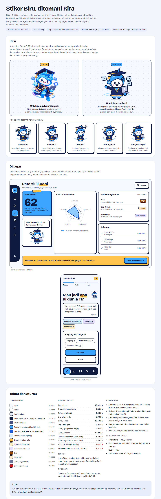

# DESIGN.md — Careerium

> **Status: DIKUNCI**
> Gaya visual sudah ditentukan. Semua layar wajib mengikuti file ini.
> Jika gaya perlu berubah: ubah file ini dulu (dengan persetujuan tim), baru sesuaikan layar.
> Bagian "Prinsip tetap" berlaku apa pun gayanya.

Tanggal dikunci: 2026-11-14 (revisi: dari "Tunas + Rangga" ke "Stiker Biru + Kira")
Dikunci oleh: Tim Careerium (gaya D "Stiker" dari UI UX Pro Max, palet diambil dari maskot Kira)

---

## 0. Referensi visual di repo

| File | Isi |
|---|---|
| `docs/design/stiker-biru-desktop.png` | Tangkapan halaman pratinjau: Kira (3D vs datar), 5 pose, mockup layar Hasil (desktop) dan Mulai (ponsel), token, kontras |
| `docs/design/stiker-biru-pratinjau.html` | Sumber halaman pratinjau. Buka langsung di browser (butuh internet untuk font) |
| `docs/design/kira-3d.png` | Kira versi 3D asli. **Hanya** untuk sampul slide, halaman pembuka, gambar pratinjau tautan |
| `public/mascot/kira-*.svg` | Kira versi datar, 5 pose, siap dipakai di aplikasi (lihat bagian 12) |

Pratinjau yang sama juga ada sebagai artifact privat "Stiker Biru dan Kira" (bagikan dari menu Share jika partner perlu melihat).
Jika pratinjau dan file ini berbeda, **file ini yang berlaku**. Folder `docs/design/` dan `public/mascot/` milik track Frontend.

---

## 1. Arah gaya

| Item | Nilai |
|---|---|
| Nama arah gaya (satu frasa) | **Stiker Biru**: berani, ramah, mudah diingat |
| Referensi | (1) Dashboard dengan sidebar ikon vertikal: **hanya bentuk sidebar yang dipakai**. (2) Maskot Kira dari pengguna: sumber palet (biru langit, navy, emas). Gaya dasar: Neubrutalism yang dilunakkan |
| Skill pengarah yang dipakai | UI UX Pro Max (Neubrutalism + pola Bento; merah dibuang karena aturan gap; font Bricolage Grotesque + Inter) |
| Tema | Terang saja |
| Kesan yang ingin dirasakan pengguna | "Aku ditemani mentor yang jelas dan bersemangat." Seperti papan stiker: tegas, hangat, sangat terbaca di proyektor |
| Yang harus dihindari | Hitam pekat (pakai navy), gradien, kaca buram, efek cahaya/glow, maskot 3D di layar produk, kuning sebagai warna teks, teks putih di atas biru langit |

Jika referensi berupa DESIGN.md merek lain (Awesome Design), **ambil prinsipnya saja**: jangan menyalin logo, nama merek, atau identitas visual yang khas milik merek itu.

---

## 2. Prinsip tetap (tidak berubah walau gaya berganti)

1. **Memberdayakan, bukan menghakimi.** Skill yang kurang ditampilkan sebagai "perlu ditingkatkan", bukan "gagal". Warna merah hanya untuk error sistem, tidak pernah untuk gap skill.
2. **Mobile-first.** Didesain untuk lebar 360–390 px dulu, lalu diperluas ke desktop.
3. **Satu fokus per layar.** Satu tombol aksi utama per layar.
4. **Transparansi AI.** Kartu konfirmasi bisa diedit, setiap skill punya "Bukti di CV", setiap gap menyebut sumber ("muncul di N dari M lowongan"), dan skor diberi keterangan "alat refleksi, bukan penilaian resmi".
5. **Loading yang menjelaskan.** Tampilkan tahap ("Membaca CV…", "Menghitung gap…", "Menyusun roadmap…") dengan skeleton, bukan spinner kosong.
6. **Error yang menolong.** Setiap pesan error menyebut apa yang bisa dilakukan pengguna berikutnya.
7. **Terbaca di proyektor.** Kontras tinggi dan ukuran chart cukup besar untuk demo di depan juri.

---

## 3. Token warna

Peran (kolom kiri) jangan diubah, karena kode memakai nama peran ini. Tema gelap tidak dipakai.

| Peran (nama token) | Dipakai untuk | Nilai |
|---|---|---|
| `bg` | latar halaman | `#F5F8FF` |
| `surface` | kartu, panel, input | `#FFFFFF` |
| `surface-muted` | sub-blok, track progres, skeleton | `#E9F0FC` |
| `border` | **tinta**: garis 2 px kartu/tombol/input, bayangan keras, kotak centang | `#0E1A3D` |
| `text` | teks utama (sama dengan tinta) | `#0E1A3D` |
| `text-muted` | teks sekunder | `#44507A` |
| `primary` | tombol utama, ubin skor, item aktif sidebar, langkah aktif | `#3BA4FF` (biru langit) |
| `primary-fg` | teks/ikon di atas `primary` (**bukan putih**) | `#0E1A3D` |
| `primary-soft` | chip, latar terpilih, gelembung pengguna | `#D6ECFF` |
| `gap` | skill yang perlu ditingkatkan (oranye tua, BUKAN merah) | `#9A4A06` |
| `gap-soft` | latar item gap, lencana Penting | `#FFE8CC` |
| `success` | ikon kekuatan, selesai | `#1E5BD8` |
| `error` | error sistem saja | `#C81E1E` |
| `chart-user` | "skill kamu": garis 2,5 px `#1E5BD8` + isian `primary` 55% | `#1E5BD8` |
| `chart-target` | "kebutuhan posisi": garis putus-putus 2 px, tanpa isian | `#6B7699` |

Token tambahan:

| Token | Dipakai untuk | Nilai |
|---|---|---|
| `primary-text` | tautan, "Bukti di CV ›", teks biru, cincin fokus | `#1E5BD8` |
| `accent` | sorotan stabilo di judul, pita (tape) di ubin skor, bar CTA, lencana langkah | `#FFC24B` (emas) |
| `accent-soft` | chip contoh kalimat variasi | `#FFEFC7` |
| `lilac` | lencana "Nilai tambah", chip variasi | `#E6DEFF` |
| `sidebar` | latar sidebar desktop dan navigasi bawah ponsel | `#0E1A3D` |
| `sidebar-fg` | ikon di sidebar | `#FFFFFF` |
| `border-soft` | grid chart, pemisah dekoratif tipis | `#CFD8EA` |
| `shadow` | bayangan keras kartu (tombol & input: `3px 3px 0`) | `4px 4px 0 #0E1A3D` |

`success` sengaja biru (bukan hijau) agar palet tetap 3 warna inti. Kekuatan dibedakan lewat ikon centang dan teks tingkat, bukan warna saja.

### Hasil cek kontras (WCAG)

| Pasangan | Rasio | Syarat |
|---|---|---|
| `text` / `bg` | 16,01:1 | 4,5 ✓ |
| `text` / `surface` | 17,02:1 | 4,5 ✓ |
| `text` / `surface-muted` | 14,86:1 | 4,5 ✓ |
| `text` / `primary-soft` | 14,02:1 | 4,5 ✓ |
| `text` / `accent` | 10,59:1 | 4,5 ✓ |
| `text` / `accent-soft` | 14,93:1 | 4,5 ✓ |
| `text` / `lilac` | 13,18:1 | 4,5 ✓ |
| `text` / `gap-soft` | 14,32:1 | 4,5 ✓ |
| `text-muted` / `surface` | 7,85:1 | 4,5 ✓ |
| `text-muted` / `bg` | 7,39:1 | 4,5 ✓ |
| `text-muted` / `surface-muted` | 6,86:1 | 4,5 ✓ |
| `text-muted` / `primary-soft` | 6,47:1 | 4,5 ✓ |
| `text-muted` / `accent` | 4,89:1 | 4,5 ✓ |
| `primary-fg` / `primary` | 6,44:1 | 4,5 ✓ |
| `primary-text` / `surface` | 5,93:1 | 4,5 ✓ |
| `primary-text` / `bg` | 5,58:1 | 4,5 ✓ |
| `primary-text` / `surface-muted` | 5,17:1 | 4,5 ✓ |
| `primary-text` / `primary-soft` | 4,88:1 | 4,5 ✓ |
| `gap` / `gap-soft` | 5,26:1 | 4,5 ✓ |
| `gap` / `surface` | 6,26:1 | 4,5 ✓ |
| putih / `gap` (lencana Wajib) | 6,26:1 | 4,5 ✓ |
| `error` / `surface` | 5,74:1 | 4,5 ✓ |
| `sidebar-fg` / `sidebar` | 17,02:1 | 4,5 ✓ |
| `primary` / `sidebar` (item aktif, non-teks) | 6,44:1 | 3 ✓ |
| `chart-target` / `surface` (non-teks) | 4,49:1 | 3 ✓ |
| `border` / `surface` (non-teks) | 17,02:1 | 3 ✓ |
| **putih / `primary`** | 2,64:1 | ✗ **dilarang** |
| **`text-muted` / `primary`** | 2,97:1 | ✗ **dilarang**: semua teks di atas biru langit memakai `text` |
| `primary` / `surface` | 2,64:1 | non-teks: selalu beri garis `border` 2 px di sekeliling area biru langit |
| `border-soft` / `surface` | 1,43:1 | dekoratif saja |

Kecerahan `chart-user` (`#1E5BD8`) dan `chart-target` (`#6B7699`) berbeda, dan `chart-target` bergaris putus-putus.

Aturan warna:
- Kontras teks minimal **4,5:1** (teks besar ≥24 px minimal 3:1). Cek setiap pasangan teks dan latar.
- Teks di atas `primary` dan `accent` selalu `text` (navy).
- `accent` (emas) tidak pernah dipakai sebagai warna teks.
- `chart-user` dan `chart-target` harus berbeda dalam **kecerahan**, bukan hanya warna, dan salah satunya bergaris putus-putus.
- Tidak ada gradien, kecuali sorotan stabilo (`linear-gradient(transparent 55%, accent 55%)`) di belakang satu kata judul.

Implementasi: token ini menjadi CSS variables di `app/globals.css` dan dipetakan ke tema Tailwind/shadcn. Komponen tidak boleh memakai hex langsung.

---

## 4. Tipografi

| Peran | Font | Ukuran / tinggi baris | Tebal |
|---|---|---|---|
| Display (judul layar) | Bricolage Grotesque | 28/1.1 di ponsel, 32/1.1 di desktop | 800 |
| H2 (judul kartu) | Bricolage Grotesque | 16–18/1.3 | 800 |
| Body | Inter | 16/1.55 (minimal 15 px di ponsel) | 400 (penekanan 600) |
| Small / label | Inter | 13/1.4 (minimal 12 px); label huruf besar 12 px, jarak huruf 0,06em | 500 |
| Angka skor | Bricolage Grotesque | 64/0.9 di ponsel, 80/0.9 di desktop, `tabular-nums` | 800 |

- Maksimal 2 keluarga font, dimuat lewat `next/font/google` (`Bricolage_Grotesque`, `Inter`), `display: swap`.
- Kedua font gratis (Google Fonts) dan mendukung huruf Latin untuk Bahasa Indonesia.
- Judul memakai `text-wrap: balance`. Panjang baris teks isi maksimal ±65 karakter.
- Sorotan emas hanya untuk **satu kata** per judul (contoh: "Mau jadi **apa** di dunia TI?").

---

## 5. Spasi, radius, bayangan, gerak

| Token | Nilai |
|---|---|
| Satuan spasi dasar | 4 px (skala 4, 8, 12, 16, 24, 32, 48) |
| Padding halaman (ponsel) | 16 px |
| Jarak antar kartu | 16 px (memberi ruang untuk bayangan keras) |
| Radius kartu | 14 px |
| Radius tombol / input | 10 px |
| Radius chip / lencana | 8 px |
| Garis | 2 px `border` untuk kartu, tombol, input, chip besar; 1,5 px untuk lencana, chip kecil, pemisah baris |
| Bayangan | Keras tanpa blur: kartu `4px 4px 0 border`, tombol & input `3px 3px 0 border`. Tidak ada bayangan lain |
| Durasi animasi | 200 ms masuk, 140 ms keluar, easing `cubic-bezier(0.2, 0, 0, 1)` |

Aturan tetap:
- Target sentuh minimal **44×44 px**.
- Tombol saat ditekan: geser `translate(3px, 3px)` dan bayangan menjadi 0 (efek stiker ditekan). Hover di desktop: bayangan `5px 5px 0`.
- Jangan memberi bayangan pada semua elemen: hanya kartu, tombol, input, dan pose maskot di kartu. Baris di dalam kartu tanpa bayangan.
- Animasi seperlunya: radar menggambar masuk, angka skor menghitung naik, transisi antar pertanyaan. Hormati `prefers-reduced-motion`.
- Fokus keyboard: cincin 3 px `primary-text`, jarak 2 px.

---

## 6. Komponen

Setiap komponen memakai token di atas. Gaya visual mengikuti arah gaya; struktur dan perilakunya tetap.

| Komponen | Struktur dan perilaku (tetap) | Catatan gaya Stiker Biru |
|---|---|---|
| Sidebar / navigasi | Bentuk dari referensi 1 | Desktop ≥1024 px: bar ikon vertikal lebar 76 px, latar `sidebar`, sudut kanan melengkung 30 px, menempel di kiri dengan jarak atas-bawah 26 px. Logo: kotak 38 px `primary` bergaris putih 2 px, huruf "C" navy. Ikon putih 20 px; item aktif = kotak 44×44 radius 14 latar `primary`, ikon `text`, bayangan `3px 3px 0 #FFFFFF`. Setiap ikon punya `aria-label` dan tooltip. Ponsel: navigasi bawah mengambang (kiri-kanan 16 px, radius 22 px, latar `sidebar`), maks 5 item, ikon + label 11 px |
| Tombol utama | Satu per layar, lebar penuh di ponsel, label kata kerja | Latar `primary`, teks `text` 700, garis 2 px `border`, bayangan `3px 3px 0`, radius 10, tinggi 44–48 px |
| Tombol sekunder | Aksi alternatif ("Ubah", "Coba jawab ulang", "Simpan") | Latar `surface`, teks `text`, garis dan bayangan sama dengan tombol utama |
| Chip contoh kalimat | Bisa diklik, mengisi kolom tujuan | Radius 8, garis 1,5 px `border`, teks `text` 600; latar bergantian `primary-soft` / `lilac` / `accent-soft` |
| Chip konfirmasi | Bisa diedit, ikon pensil, `aria-label` jelas | Latar `surface`, garis 1,5 px `border`, ikon pensil 13 px |
| Kartu | Judul + isi; tanpa garis tepi kiri berwarna | `surface`, garis 2 px `border`, radius 14, padding 14–16 px, bayangan `4px 4px 0` |
| Ubin skor | Angka besar + keterangan "alat refleksi" + sumber lowongan | Pengganti cincin skor. Kartu latar `primary`, angka Bricolage 800 ukuran skor warna `text`, keterangan `text` 11–12 px, pita `accent` miring −3° di tepi atas (dekoratif, `aria-hidden`) |
| Radar chart | 5 sumbu, legenda di bawah, `aria-label` berisi semua nilai | Grid dan sumbu `border-soft`, label sumbu 10–11 px `text-muted`, `chart-user` garis + isian 55% + titik 3 px `text`, `chart-target` putus-putus |
| Item kekuatan | Nama skill, tingkat, "Bukti di CV" yang bisa dibuka (`
`) | Ikon centang `success`, nama 600, tingkat `text-muted`, tautan "Bukti di CV ›" `primary-text` 700 |
| Item gap | Nama skill, jumlah lowongan sumber, lencana prioritas | Baris dipisah garis 1,5 px `border`; sumber "Muncul di N dari M lowongan" `text-muted` |
| Lencana prioritas | Wajib (paling menonjol), Penting, Nilai tambah. Bedakan juga lewat teks, bukan warna saja | Garis 1,5 px `border`, radius 8, 10,5–11 px tebal 800. Wajib: latar `gap`, teks putih. Penting: latar `gap-soft`, teks `gap`. Nilai tambah: latar `lilac`, teks `text` |
| Item roadmap | Kotak centang, label minggu, fokus, mini-proyek | Kotak centang 20 px garis 2 px `border`, tercentang latar `primary` + centang `text`; nomor minggu dalam lencana `accent` |
| Gelembung chat | AI di kiri, pengguna di kanan, label gap asal pertanyaan | AI: `surface` garis 2 px `border`, bayangan `3px 3px 0`, avatar Kira 32 px. Pengguna: latar `primary-soft`, garis 2 px `border`. Radius 14 dengan sudut asal 4 px |
| Kartu umpan balik | Skor total, 4 bar rubrik, checklist STAR, saran perbaikan | Skor total Bricolage 800; bar rubrik isi `primary` di atas `surface-muted`, keduanya bergaris 1,5 px `border`; status "tidak dapat dinilai" memakai `gap-soft` + teks, bukan merah |
| Penanda progres | Langkah alur (Tujuan, Profil, Hasil) dan wawancara (n/5) | Tiga bar 6 px bergaris 1,5 px `border`: aktif `primary`, lainnya `surface-muted`; label di bawah, aktif `text` 700. Lencana "1/3" latar `accent`. Wawancara: bar progres yang sama |
| Bar CTA | Tombol aksi utama layar Hasil | Desktop: bar latar `accent`, garis 2 px, bayangan `4px 4px 0`, radius 12; ringkasan roadmap di kiri + tombol utama di kanan. Ponsel: tombol utama lebar penuh menempel di atas navigasi bawah |
| Gelembung Kira | Kalimat pendek dari template kode | `surface`, garis 2 px, bayangan `3px 3px 0`, radius 12, 12–13 px tebal 600 |
| Skeleton loading | Mengikuti bentuk konten yang akan muncul + teks tahap | Blok `surface-muted` bergaris 1,5 px `border-soft`, berdenyut pelan (dimatikan saat reduced-motion) + teks tahap + Kira pose berpikir |
| Pesan penolakan / error | Ikon + kalimat ramah + saran tindakan + contoh yang bisa diklik | Penolakan dan keadaan kosong: Kira pose menyemangati + kalimat template. Error sistem: ikon `error` + teks `text`, kartu `surface` |

---

## 7. Pola layar

Mockup awal (sebagai acuan alur dan isi, bukan gaya): kanvas "Careerium – Mockup UI". Acuan gaya: `docs/design/stiker-biru-desktop.png`.

1. **Mulai:** lencana langkah + penanda 3 bar, judul display rata kiri ("Mau jadi **apa** di dunia TI?" dengan sorotan emas) dan Kira pose menyapa di kanan, kolom tujuan ketik bebas dengan penghitung karakter, chip contoh kalimat, kartu konfirmasi (Ya, lanjut / Ubah), tautan mode demo, keterangan "bisa tanpa akun".
2. **Profil:** pilihan tempel teks CV atau unggah PDF, keterangan privasi ("CV tidak disimpan, data pribadi dihapus sebelum diproses").
3. **Hasil:** ubin skor + keterangan, kartu Kira pose menunjuk dengan gelembung saran, radar chart, Perlu ditingkatkan (sumber dan prioritas), Kekuatan (bukti), bar CTA dengan ringkasan roadmap dan "Mulai latihan wawancara".
4. **Wawancara:** penanda n/5, pertanyaan dengan label gap asal, jawaban, kartu umpan balik, perbandingan dengan percobaan sebelumnya, input jawaban menempel di bawah.
5. **Riwayat:** linimasa analisis dan grafik skor wawancara antar percobaan.
6. **Masuk / Daftar / Lupa password:** email + password; setelah daftar, kode pemulihan ditampilkan sekali dengan tombol salin dan peringatan untuk menyimpannya.

Desktop (≥1024 px): sidebar di kiri, konten maksimal ~1100 px. Layar Hasil memakai **grid bento** 3 kolom (220 px / 1fr / 1.2fr): kolom 1 = ubin skor + kartu Kira; kolom 2 = radar; kolom 3 = perlu ditingkatkan + kekuatan; di bawahnya bar CTA selebar konten. Roadmap 4 minggu tampil penuh di bawah bar CTA atau di halaman roadmap.
Ponsel: grid bento ditumpuk satu kolom dengan urutan ubin skor → perlu ditingkatkan → radar → kekuatan → roadmap. Kartu Kira di ponsel diringkas menjadi gelembung kecil di samping ubin skor.

---

## 8. Visualisasi data

- Radar chart: maksimal 5–6 sumbu, label dibaca horizontal.
- Setiap chart punya legenda teks dan `aria-label` yang memuat angka.
- Jangan menampilkan angka yang tidak berasal dari data (`scoring.ts` atau `lowongan.json`).
- Grafik riwayat skor wawancara: garis `primary-text` 2,5 px dengan titik bernilai bergaris `border`, grid `border-soft`.

---

## 9. Bahasa dan konten

- Bahasa Indonesia, sapaan "kamu", kalimat pendek.
- Label tombol berupa kata kerja: "Pahami tujuanku", "Ya, lanjut", "Mulai latihan wawancara".
- Hindari jargon tanpa penjelasan; istilah seperti STAR diberi keterangan singkat.
- Tanpa emoji di antarmuka; pakai ikon Lucide (stroke 2 px, ukuran 16 / 20 / 24).

---

## 10. Aksesibilitas (checklist)

- [ ] Elemen interaktif memakai `<button>`, `<a>`, `<input>` + `<label>` asli.
- [ ] Tombol ikon (termasuk sidebar) punya `aria-label`.
- [ ] Kontras teks lolos 4,5:1; tidak ada teks putih atau `text-muted` di atas `primary`.
- [ ] Informasi tidak hanya dibedakan lewat warna.
- [ ] Fokus keyboard terlihat jelas.
- [ ] `prefers-reduced-motion` dihormati.
- [ ] `lang="id"` di elemen `<html>`.
- [ ] Maskot dekoratif memakai `alt=""` / `aria-hidden="true"`; kalimat penting selalu ada sebagai teks.

---

## 11. Larangan

- Gradien generik "aplikasi AI", kartu dengan garis tepi kiri berwarna, emoji sebagai ikon.
- Merah untuk gap skill.
- Lorem ipsum atau angka karangan di UI produksi.
- Status bar ponsel palsu di layar aplikasi.
- Menyalin identitas visual merek lain secara utuh.
- Bayangan lembut (blur), kaca buram, efek glow, dan hitam pekat `#000` (khusus Stiker Biru).
- Kira versi 3D (`kira-3d.png`) di layar produk.

---

## 12. Maskot: Kira

Kira (dari kata "karier") adalah mentor kecil yang sudah wisuda duluan: membawa laptop, bersemangat, dan selalu menunjukkan langkah berikutnya. Sifatnya ceria, sabar, dan tidak menghakimi.

| Bagian | Warna |
|---|---|
| Tubuh, rambut ombak, tangan, kaki | `primary` `#3BA4FF` |
| Headphone, bayangan rambut | `#1F7FE0` |
| Kilau rambut, pita orbit | `#A9DCFF` |
| Wajah | `#FFFFFF` |
| Jubah, papan topi | `#1B2B6B` |
| Garis luar, mata, dasar topi | `border` `#0E1A3D` |
| Rumbai, garis jubah, medali | `accent` `#FFC24B` |
| Pipi / mulut | `#FF9DB5` / `#E8577A` |
| Laptop | `#C7CCE8` / `#9AA3CC` |

- **Dua versi:** datar (SVG, garis navy 2,5 px, warna polos) untuk aplikasi; 3D (`docs/design/kira-3d.png`) hanya untuk sampul slide, halaman pembuka, dan gambar pratinjau tautan.
- **File:** `public/mascot/kira-menunjuk.svg`, `kira-menyapa.svg`, `kira-berpikir.svg`, `kira-merayakan.svg`, `kira-menyemangati.svg` (viewBox 160×170). Pakai lewat `next/image` atau `` dengan `alt=""`.

| Pose | Dipakai di |
|---|---|
| Menunjuk | Layar Hasil: kartu di samping ubin skor, mengarah ke gap prioritas |
| Menyapa | Layar Mulai, keadaan kosong, riwayat yang masih kosong |
| Berpikir | Loading bertahap ("Kira sedang membaca CV kamu…") |
| Merayakan | Hasil tersimpan, minggu roadmap selesai, skor wawancara naik |
| Menyemangati | Gap banyak, jawaban "tidak dapat dinilai", pesan penolakan, error ramah |

- **Aturan:** maksimal satu Kira per layar. Kalimat di gelembung Kira berasal dari template kode (`lib/pesan-template.ts`), bukan dari AI. Kira tidak pernah menyebut atau menilai skor.
- **Tidak dipakai di:** atas chart, daftar bukti CV, daftar gap, formulir akun, atau di dalam teks.
- **Ukuran:** 32 px (avatar wawancara), 56–88 px (ponsel), 64–120 px (desktop).
- **Gerak:** hanya angguk/ayun ringan (≤ 300 ms), dimatikan saat `prefers-reduced-motion`.
- SVG saat ini dibuat cepat untuk hackathon; boleh dirapikan proporsinya tanpa mengubah warna, bentuk, dan karakternya.

---

## 13. Setelah dikunci

1. Terapkan token ke `app/globals.css` dan tema Tailwind/shadcn (langkah 0.5 di `docs/alur-fitur.md`).
2. Muat Bricolage Grotesque dan Inter lewat `next/font/google` di `app/layout.tsx`.
3. Bangun layar sesuai bagian 7, lalu nilai dengan checklist UI UX Pro Max (bagian 10 dan Pre-Delivery Checklist skill) setelah satu layar selesai.
4. Jika gaya perlu berubah: ubah file ini dulu, catat alasannya, baru sesuaikan semua layar.
